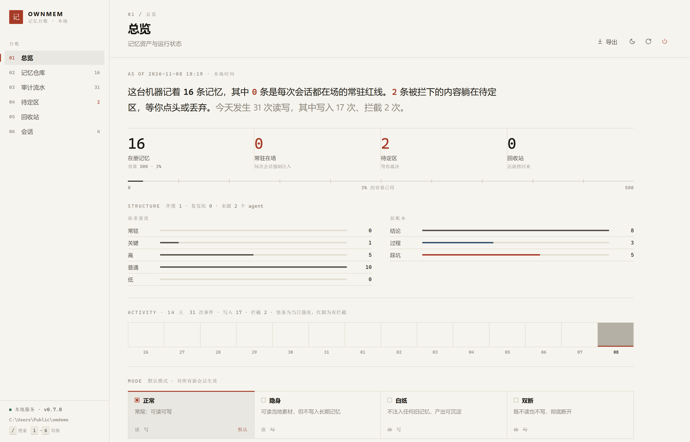
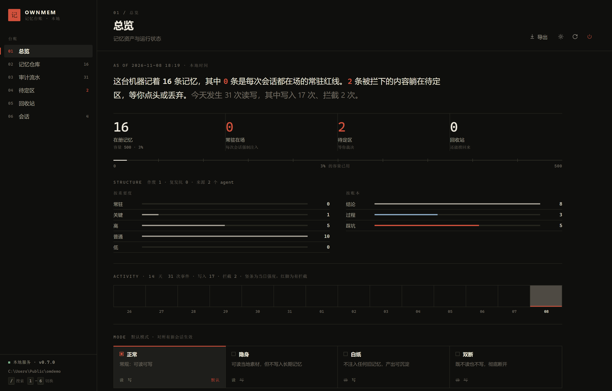

# OwnMem

> **Own your memory.** 你的 agent 的记忆，归你看、归你管、归你抹去。

OwnMem 是给 AI agent 用的**记忆控制层**。它把「你的 agent 记住了什么」从黑箱变成一本可查的账：

| 痛点 | 现状 | OwnMem |
|------|------|--------|
| **记忆偏见** | 旧画像自动注入，agent 拿不完整的你代表全部的你 | 白纸模式：本轮不注入任何历史记忆 |
| **agent 不查记忆** | 记忆工具靠模型自觉调用，大多数时候没人查 | 自动召回：挂在 hook 上，记忆主动进场 |
| **看不见、删不掉** | agent 背着你存了什么，无从得知 | 审计日志 + 会话回执：每次读写都有账 |

零依赖（纯标准库）、数据 100% 本地、支持任何能接 MCP 的 agent。

<p align="center">
  
  
</p>
<p align="center">
  <em>Web 审计台：总览（纸白 / 墨黑双主题）。左侧还有记忆仓库、审计流水、待定区、回收站与会话视图。</em>
</p>

---

## 四种模式

| 模式 | 读记忆 | 写记忆 | 用途 |
|------|:------:|:------:|------|
| `normal` | ✅ | ✅ | 日常 |
| `incognito` | ✅ | ❌ | **隐身**：像浏览器无痕，会话内容不进长期记忆 |
| `blank` | ❌ | ✅ | **白纸**：不用旧印象回答，产出仍可沉淀 |
| `ghost` | ❌ | ❌ | 双断：既不读也不写 |

关键设计：**隐身 ≠ 失智**。会话内的记忆照常工作，分界线只在「落盘」那一刻。隐身模式下被拦下的内容会进入**待定区**，会话结束由你白名单式挑选保留。

---

## v2：三本账 / 项目隔离 / 会话沉淀 / 治理 / 视角

v1 解决「记得住」，v2 解决「记得清、接得上、账不烂、看得对」。全部向后兼容——
旧库自动升级，老记忆落成「结论账 + 全局」，召回行为一个字不变。

### 三本账（kind）

| 账本 | 记什么 | 例子 |
|---|---|---|
| `conclusion` 结论 | 定下来的事实与决定 | 「存储层定了 SQLite，不引 Postgres」 |
| `process` 过程 | 当时是怎么想的、为什么这么定 | 「单机工具没有并发压力，运维成本更值钱」 |
| `pitfall` 踩坑 | 哪条路走不通、为什么 | 「WAL 模式放在网络共享盘上会一直锁死」 |

踩坑账的设计取向：**坑不是影响，是遗产**——新 agent 接手时应当看得到，别重复踩。

```bash
ownmem add "踩坑：xxx 走不通" --kind pitfall
ownmem search "角色卡" --kind pitfall     # 只搜某本账
```

### 项目隔离（project）

记忆按项目分家，`project=""` 是**全局**——红线、身份事实这类跟项目无关的东西永远在场。

```bash
ownmem project ownmem      # 本会话归属 ownmem
ownmem project ownmem --default   # 同时设成新会话的默认归属（否则每个新对话都要重设）
ownmem project             # 看当前归属
ownmem project --clear     # 回到全局（不做隔离）
OWNMEM_PROJECT=research ownmem recall --prompt "..."   # 接入方用环境变量约定
```

刻意不从工作目录猜项目名：WorkBuddy 每次会话的工作区是时间戳目录，
拿它当项目等于一条会话一个项目，隔离就成了噪音。项目归谁，由人明确指定。

### 会话沉淀（digest）

会话结束时把「这次干到哪了」落成一行；**同一项目的新会话第一轮自动注入**，
不必再靠人复述前情。这是跨对话延续感的来源。

```bash
ownmem session-end --note "今天把 v2 的 P0 做完了"   # 结束会话 + 沉淀（SessionEnd hook 就是它）
ownmem digest                    # 看同项目上一次的沉淀
ownmem digest --list             # 最近的沉淀列表
ownmem digest --write --note "…" # 不结束会话，只补一条沉淀
```

沉淀是**确定性生成**的：从审计流水与本次写入里抽事实拼成一段，不调用模型——
零依赖、可复现、不花钱。空会话（无写入、无召回、无要点）不落盘，避免变成噪音。
MCP 侧多了一个 `last_progress` 工具，agent 想主动接手也可以拉。

### 取代链（supersede）

结论被推翻时**不删旧条**，而是挂一条链：旧条标「已被 XX 取代」，不再参与召回，
但永远查得到。「曾经以为是 A，后来改成 B，因为……」——这个证据链本身就是记忆，
真删了下次还会有人（或另一个 agent）重新提出 A。

```bash
ownmem supersede m_20261106_abc "预算改为可配置，默认 3000 字"   # 写新条 + 作废旧条
ownmem add "…" --supersedes m_20261106_abc                       # 等价写法
ownmem chain m_20261106_abc      # 这条推翻了谁 / 又被谁推翻
ownmem search "预算" --superseded # 考古：把作废的也搜出来
```

被取代过的旧条不能再被取代一次（避免分叉），要接着改就取代「最新那一版」。

### 踩坑计数器（recur）

同一个坑被**再次踩中**时不新增条目，只累加复发次数和「谁栽过」。
理由很直接：两条一模一样的坑只会稀释注意力，真正有价值的信号是
「这个坑两个 agent 都栽过」——它在召回里权重更高（每次复发 +12%，
跨 agent 再 +10%）。

```bash
ownmem add "踩坑：sed 改 CRLF 文件会把整份文件变一行" --kind pitfall --agent claude
# 换 codex 再写同样的内容 →
# 这个坑已经记过了（id=…），本次计为第 1 次复发（栽过的：claude/codex）
ownmem show m_xxx      # 看复发次数与栽过的名单
```

### 衰减与晋级（upgrade）

- **衰减**：所有记忆按时间衰减，重要度低的掉得更快（`low` 半衰期 ×0.6，`high` ×1.15）。
  地板 0.35——老记忆会退到后排，但不会被悄悄抹掉。
- **晋级**：过程账被召回 ≥5 次、且出现在 ≥3 个不同会话里 → 自动升为结论账。
  每次 `session-end` 顺手结算一次（不需要人记得）。

```bash
ownmem upgrade --dry-run     # 先看哪些过程账够格
ownmem upgrade               # 执行晋级
ownmem doctor                # 治理体检：三个账本各多少、多少作废、多少坑在复发、哪些快淡出
```

### 注入预算（budget）

每轮注入的字数定额，可调；超出预算的**长条被跳过而不是一刀截断**，
后面的短条仍能填满剩余空间。

```bash
ownmem budget                    # 看当前生效值
ownmem budget --recall 3000      # 相关记忆预算（默认 2400 字）
ownmem budget --always 3500      # 常驻规则预算（默认 2800 字）
ownmem budget --reset            # 恢复默认
```

### 会话视角（view）

mode 管「能不能读」，view 管「读的时候**看到什么**」——两个维度正交，
blank/ghost 仍整体断读，view 只在可读时有意义。

| 视角 | 看到什么 | 用途 |
|---|---|---|
| `normal` | 全量 | 接着上一家干 |
| `result-only` | 结论+踩坑，隐藏过程账 | 接手但保留自己的判断 |
| `blind-review` | **只有踩坑账+常驻规则**，旧结论/思路/上次进度全隐藏 | 让新 AI 挑上一个 AI 的毛病、发散新方案 |
| `cross-check` | 全量 + 对抗提示「旧结论可能是错的，逐条验证」 | 交叉验证 |

盲审是**软**的：OwnMem 只管自己注入的上下文，管不住 agent 自己去读
磁盘上的遗留文件——所以盲审提示词里会明说「上一个 AI 可能留了文件，
读不读你自己决定」。知情比强制现实。踩坑账任何视角都可见：坑是事实
遗产不是观点影响，新 AI 不该把别人踩过的坑再踩一遍。

```bash
ownmem view                    # 看四档说明与当前档位
ownmem view blind-review       # 切盲审（支持中文：盲审/交叉/只看结论）
ownmem view normal             # 切回全量
```

### 先答后对（answer-first）

压「上下文锚定」最狠的一招，真人评审同款流程——**先独立打分，再对分**：

```bash
ownmem answer-first begin                 # 第 1 阶段：旧记忆全屏蔽（红线保留）
# …让 agent 只凭任务独立作答…
ownmem answer-first submit "我的方案是…"  # 独立方案原文存档
ownmem answer-first reveal                # 第 2 阶段：注入「你的方案原文+旧记忆」
                                          # 让它逐点对照、单独列分歧点
ownmem answer-first cancel                # 收尾清状态
```

价值在第 2 阶段的注入方式：你的独立方案是**一字未改的原文**，对照的
是「没被旧记忆污染的你」vs「旧结论」——比单纯藏起来再问更能压训练趋同。

### 分歧报告（divergence）

「AI 比我强，所以我只会顺从」的解药：人判断不了趋同，只能判断分歧。
它检索某话题下的结论，把**来自不同 agent 的相似说法**配对并排展示，
你只对分歧点做判断，不对整篇做判断。

```bash
ownmem divergence "栏目 更新 频率"        # 谁在哪一步说了不一样的
ownmem divergence "…" --all-projects      # 跨项目查
```

配对窗口 0.10–0.90：上限滤复述（那是判重通道的领地），下限取这么低是
实测出来的——**分歧越大、用词越不重合**（「每周三更」vs「改成每周两更，
质量优先」bigram 相似度只有 0.19），窗口定高了漏掉的恰恰是最值得上桌的
分歧。已被取代链作废的结论自动不上桌（它有裁决了）。MCP 侧同名工具
`divergence_report`，agent 发现旧结论互相矛盾时也会主动调。

---

## 安装

```bash
pip install -e .          # 本地开发（进入项目目录，会生成 ownmem 命令）
```

要求 Python ≥ 3.10，**零第三方运行时依赖**（MCP stdio 是自带实现，不需要官方 mcp 包）。

不方便 pip 安装时（Windows 零安装模式），用 PYTHONPATH 直跑：

```bat
set PYTHONPATH=C:\path\to\ownmem
python -m ownmem.cli status
```

自检：

```bash
ownmem doctor
```

---

## 接入 Claude Code

### 1. MCP 工具（让 agent 能读写记忆）

`~/.claude.json` 或项目 `.mcp.json`。已 `pip install -e .` 时：

```json
{
  "mcpServers": {
    "ownmem": {
      "command": "ownmem",
      "args": ["mcp"],
      "env": { "OWNMEM_AGENT": "claude-code" }
    }
  }
}
```

没装 pip 包时用模块方式（Windows 实测可用的形态）：

```json
{
  "mcpServers": {
    "ownmem": {
      "type": "stdio",
      "command": "C:\\<Python路径>\\python.exe",
      "args": ["-m", "ownmem.mcp_server"],
      "env": {
        "PYTHONPATH": "C:\\path\\to\\ownmem",
        "PYTHONUTF8": "1",
        "OWNMEM_AGENT": "claude-code"
      }
    }
  }
}
```

> `PYTHONUTF8=1` 不是必需（协议输出已全 ASCII 化），但在中文 Windows 上建议保留。

### 2. Hook 自动召回（关键一步）

`~/.claude/settings.json`：

```json
{
  "hooks": {
    "UserPromptSubmit": [
      {
        "hooks": [
          {
            "type": "command",
            "command": "ownmem recall --hook claude",
            "timeout": 10
          }
        ]
      }
    ]
  },
  "SessionEnd": [
    {
      "hooks": [
        {
          "type": "command",
          "command": "ownmem session-end"
        }
      ]
    }
  ]
}
```

这样每次你发消息，OwnMem 先把相关记忆检索出来、按预算渲染好、直接塞进这轮上下文——**不经过模型的选择，它想不看到都难**。会话结束时 `session-end` 自动结算一张记忆回执，「这次对话留了什么账」不用你自己记着查。这是 OwnMem 与「又一个记忆库」的分界线。

> 详细说明与排错：见 `docs/claude-code-hook.md`

### 3. 接入任何 agent：三档适配器

**先看清楚问题在哪。** MCP 工具是「拉」模型——只有模型主动调用才生效，
而模型并不知道自己缺什么信息，所以它不会去查。"记忆库建了却没人用"就是这么来的。

正确的做法是让记忆**在模型看见之前就进场**。但不同 agent 给的权限不一样，
所以分三档，能力从高到低自动降级：

| 档 | 机制 | 适用范围 | 注入可靠性 |
|---|---|---|---|
| **A** | 原生 hook | Claude Code、OpenCode | ★★★★★ 强制注入 |
| **B** | 本地模型网关（改 `base_url`） | **任何能改 base_url 的客户端**——Qoder / Trae / Codex / ZCode / CodeBuddy / Cline / 各类 OpenAI 兼容客户端 | ★★★★☆ 强制注入 |
| **C** | 约定文件（`AGENTS.md` / rules） | 几乎所有 | ★★☆☆☆ 软约束，模型可能忽略 |

#### A 档：hook（有就优先用）

**Claude Code** —— `UserPromptSubmit` hook，见上一节。

**OpenCode** —— 插件系统暴露了 `chat.message`、`chat.params`、`tool.execute.before`、
`command.execute.before` 等事件（`@opencode-ai/plugin`）。
在 `chat.message` 里调一次 `ownmem recall`，把结果并入这一轮上下文即可，
等价于 Claude Code 的 `UserPromptSubmit`。

MCP 部分（`opencode.json`）：

```jsonc
{
  "mcp": {
    "ownmem": {
      "type": "local",
      "command": ["ownmem", "mcp"],
      "enabled": true,
      "environment": { "OWNMEM_AGENT": "opencode" }
    }
  }
}
```

#### B 档：模型网关（没有 hook 时用这个，覆盖面最广）

绝大多数 agent 不给你 hook，但它们**都要配 `base_url`**。
把 `base_url` 指向 OwnMem 网关，记忆就在请求发出前被注入——**不需要 agent 配合任何东西**：

```bash
# 1. 起网关（--upstream 填你原本的模型 API base）
ownmem gateway --port 8790 --upstream https://token.sensenova.cn/v1 --agent my-agent

# 2. 改 harness 的 base_url
#    https://token.sensenova.cn/v1   →   http://127.0.0.1:8790/v1
#    其余（apiKey、model 名）原样不动
```

网关做四件事：取出这一轮的 user 输入 → 查 OwnMem（**走白纸/隐身闸门**）→
注入 system → 记审计 → 转发给真上游并流式回传。

- 白纸模式下**不注入**，隐身模式下不写入——模式在网关层同样生效
- 支持 OpenAI `chat/completions` 与 `responses`（Codex 用 `wire_api="responses"`）两种线格式
- 密钥只做转发，不落盘、不写日志；默认只监听 `127.0.0.1`

配置细节与排错：`docs/gateway.md`

其他支持 MCP 的工具（Cline、Roo Code、Gemini CLI…）同理，MCP 命令都是 `ownmem mcp`。

---

## 用法

```bash
ownmem mode                              # 看当前模式
ownmem mode incognito                    # 切隐身（本次会话不写入记忆）
ownmem mode blank                        # 切白纸（不注入旧记忆）
ownmem status                            # 状态一览
ownmem recall --prompt "上次说的那个方案"  # 手动召回，看会注入什么
ownmem audit --limit 20                  # 审计流水
ownmem receipt                           # 会话回执：读了几条、写了几条、拦了几次
ownmem session-end                       # 结束会话并出回执（也是 SessionEnd hook 入口，默认自动沉淀）
ownmem project ownmem                    # 本会话归属项目（记忆按项目分家）
ownmem digest                            # 看「上次干到哪了」的沉淀
ownmem digest --list                     # 沉淀列表
ownmem staged                            # 待定区（隐身时被拦下的内容）
ownmem promote --ids p_001               # 挑选保留
ownmem discard --ids p_002               # 丢弃
ownmem wipe --agent-filter x --hard --yes  # 彻底抹除某来源（物理删除+清审计摘录，不可恢复）
ownmem ui                                # 打开 Web 审计台（127.0.0.1:8787）
ownmem add "..."  --auto                 # 自动提炼模式：先过质量闸门，存疑的进待定区
ownmem triage "这段要不要记"              # 干跑闸门，看会被怎么裁决（不写库）
ownmem edit m_xxx "改写后的内容"          # 就地改写，不留平行副本
ownmem supersede m_xxx "新的结论"         # 推翻一条旧结论（旧条作废但保留，可追溯）
ownmem chain m_xxx                        # 看取代链：推翻了谁 / 又被谁推翻
ownmem view blind-review                  # 切会话视角（normal/result-only/blind-review/cross-check）
ownmem answer-first begin|submit|reveal   # 先答后对：盲答 → 存档 → 对照
ownmem divergence "话题"                   # 分歧报告：不同 AI 的说法并排上桌
ownmem upgrade --dry-run                  # 治理：哪些过程账够格升为结论账
ownmem budget                             # 看/调每轮注入预算（--recall / --always）
ownmem doctor                             # 体检：注意力健康 + 治理健康
ownmem unreached                          # 僵尸记忆体检：怎么问都召不回来的那些
```

## 写入侧闸门：为什么自动提炼不会堆成屎山

召回侧的注意力是**定额**的：常驻预算 + 相关预算，两条加起来就那么多字，
多写进去一条低信息密度的内容，就意味着别的东西少分一点。
所以写入侧不设门槛，等于给未来的自己收一笔长期注意力税——今天看着无害，
半年后几十条「用户说今天天气不错」挤在一起，真正该记住的就被稀释掉了。

OwnMem 的做法是**入口配额**，不是事后清理。`ownmem add --auto`（或 MCP
的 `add_memory` 传 `channel="auto"`）会先走质量闸门：

| 裁决 | 什么样的内容 | 去处 |
|---|---|---|
| 丢弃 | 寒暄应答、提问、过短且无实体词 | 连待定区都不占，直接不留 |
| 存疑 | 中间过程、时点安排、信息密度低 | 进待定区，**30 天不挑就自动过期** |
| 沉淀 | 含结论/规则信号（红线、必须、教训、口径…） | 直接进长期记忆 |

三条设计取舍：

1. **`always` / `critical` 不过闸门。** 被人类显式标成红线的内容不该被
   文本形态筛掉——筛掉它的代价，比放过一百条寒暄大得多。
2. **存疑的默认去向是「待定区」而不是「丢弃」。** 算法可以做初筛，
   但「这条该不该留」最后由人决定；待定区会过期，等于把遗忘权交还给时间，
   而不是让算法偷偷删掉。
3. **默认仍然是 `explicit`。** 用户明确说「帮我记住这个」时不过闸门——
   人不该被自己的工具质疑。

配套的两个体检入口：

- `ownmem doctor` 会算出「库里的内容够塞满几轮召回预算」，并列出超 200 字
  会被预览截断的条目——**最要命的半句往往在尾巴上**（隐私红线第 ③ 条就曾
  在第 200 字处被切断）。
- `ownmem unreached` 列僵尸记忆：写进去了却怎么用真实提问都召不回来的那些。
  这些才是真正被浪费的记忆——不是重复，是根本没被用过。

### Windows 本机：一键启动审计台

审计台是前台服务，**进程结束即停**——所以别让它寄生在某个 agent 会话里（agent 会话一结束它就没了）。
双击桌面的 `OwnMem 审计台.vbs` 即可（静默启动，没有黑窗口）：

- 已在运行 → 直接开浏览器
- 没在运行 → 后台隐藏启动，等端口真的就绪再开浏览器
- 启动失败 → 弹窗给出原因 + 日志尾部，并可一键打开 `webui.log`

停止：网页右上角「停止服务」按钮。排障：双击项目里的 `ownmem-ui.cmd`（保留黑窗口，看得见报错）。

页面本身：深色 / 浅色双主题（默认跟随系统，可手动切换并记住选择），
支持 `?view=audit&theme=dark`、`?view=memories&memory=m_xxx` 这类深链直达某页或某条记忆。
审计事件、会话视角、三本账的文案统一由后端 `/api/meta` 下发，前端不再各写一份。

源码在 `scripts/ownmem-audit-console.vbs`（UTF-8，便于编辑）。部署到桌面时必须转成 **GBK**——
Windows 脚本宿主按系统 ANSI 代码页解码 `.vbs`，UTF-8 的中文会变乱码：

```bash
python scripts/install-desktop-launcher.py    # 转码 + 安装到桌面 + 回读校验
```

验证脚本（改了启动器之后跑一遍）：

```bash
python scripts/test_launcher_cmdline.py        # 校验 cmd /c 引号拼接是否可用
python scripts/check_launcher_syntax.py        # cscript 语法校验（不弹浏览器）
python scripts/check_launcher_startpath.py     # 端到端验证「启动服务」路径
python scripts/check_launcher_logtail.py       # 验证日志尾部读取（中文不乱码）
```

### 会话回执长这样

```
会话 s_mcp6 的记忆回执：
  · 召回注入 0 次，涉及 0 条记忆
  · 写入记忆 0 条（另有 1 次被隐身模式拦截）
  ✅ 本次会话未向长期记忆写入任何内容。
```

「我不会存」不是承诺，是一张能查的账。

---

## MCP 工具

| 工具 | 作用 |
|------|------|
| `recall` | 召回相关记忆并返回可注入上下文 |
| `search_memory` | BM25 检索记忆仓库 |
| `add_memory` | 写入记忆（**过闸门**，隐身模式下被拦并转待定区） |
| `session_mode` | 查询/切换 normal / incognito / blank / ghost（**只能调向更私密**，放宽需用户操作） |
| `list_staged` / `promote` / `discard` | 查看待定区 / 挑选保存 / 丢弃 |
| `audit_log` / `session_receipt` | 审计流水 / 会话回执 |
| `get_memory` / `delete_memory` / `restore_memory` | 读全文 / 删除（进回收站）/ 恢复 |
| `wipe_source` | 抹除某来源的全部记忆（软删除；物理抹除请用 CLI `wipe --hard`，模型不可调用） |
| `memory_stats` | 运行状态 |

---

## 诚实的隐私边界

OwnMem 管得住**经过 OwnMem 通道**的记忆读写。harness 自带的记忆机制（例如 Claude Code 自行维护的 `CLAUDE.md`、平台级画像）不经过本通道，OwnMem 不假装能拦截它们——对这些，它提供的是「查看方法 + 关闭指引」。

审计账本同样有边界，说清楚：

- 审计流水默认会留存写入/拦截内容的**前 120 字摘录**（召回留存 80 字），这是「可查的账」的一部分。介意的话设 `OWNMEM_AUDIT_DETAIL=hash`，账本只记内容指纹、不留原文。
- `wipe` 默认进回收站（可恢复）；`wipe --hard` 物理删除并收缩数据库，**同时清空这些记忆在审计里的内容摘录**。隐身模式被拦内容因没有记忆 ID 关联，其摘录无法被 --hard 定向清除——同一拓扑下，`OWNMEM_AUDIT_DETAIL=hash` 是彻底方案。
- 会话模式只能**调紧不能调松**（通过 MCP 的模型侧）；放宽模式必须由用户在 CLI 或审计台操作。

> 可验证的局部诚实，胜过不可验证的全局承诺。

---

## 架构

```
ownmem/
├── ownmem/
│   ├── core/          # 内核：SQLite 存储、BM25 检索、双判据判重、容量淘汰、审计、会话模式
│   ├── gateway/       # 咽喉层：recall 自动召回 / policy 写入闸门 + 挑选保存 / audit 审计
│   ├── mcp_stdio.py   # 零依赖 MCP stdio 实现（initialize / tools/list / tools/call）
│   ├── mcp_server.py  # 18 个 MCP 工具
│   ├── cli.py         # 命令行 + hook 入口（UserPromptSubmit / SessionEnd）
│   └── webui.py       # Web 审计台（带 Host/Origin/专有头三重跨站防护）
└── tests/test_e2e.py  # 端到端测试（20+ 项）
```

数据目录：`~/.ownmem/ownmem.db`（可用 `OWNMEM_HOME` 覆盖）。全部本地，无任何网络上传。

### 为什么自己实现 MCP stdio

实测本机 `mcp 2.0.0` 的 stdio 传输对任何请求都不响应（最小样例同样如此），而 stdio 正是 Claude Code / OpenCode 接入 MCP 的唯一方式。同时该版本还与 `pydantic ≥2.9` 存在构造期冲突。OwnMem 因此自己实现了 MCP 协议的子集：**零依赖、可自证、行为可控**（协议输出恒为 ASCII，任何 locale 的宿主都安全）。

---

## 开发

```bash
python tests/test_e2e.py     # 端到端测试，使用临时数据目录，不污染真实记忆
```

## License

MIT
